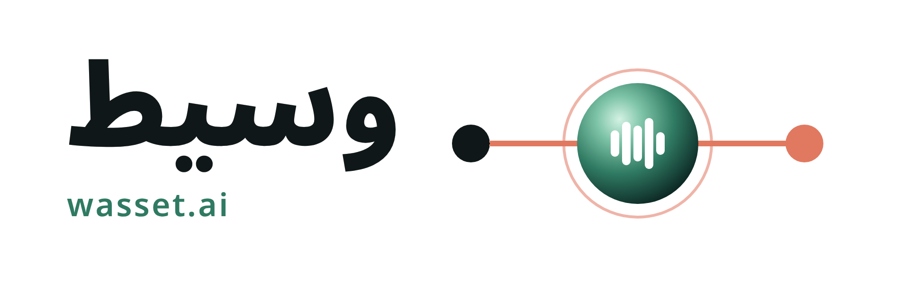
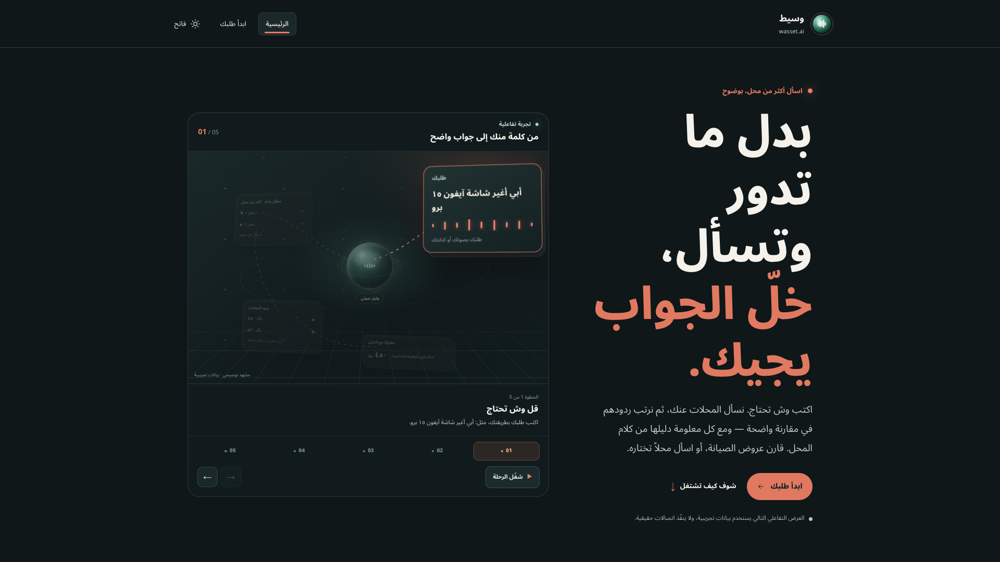
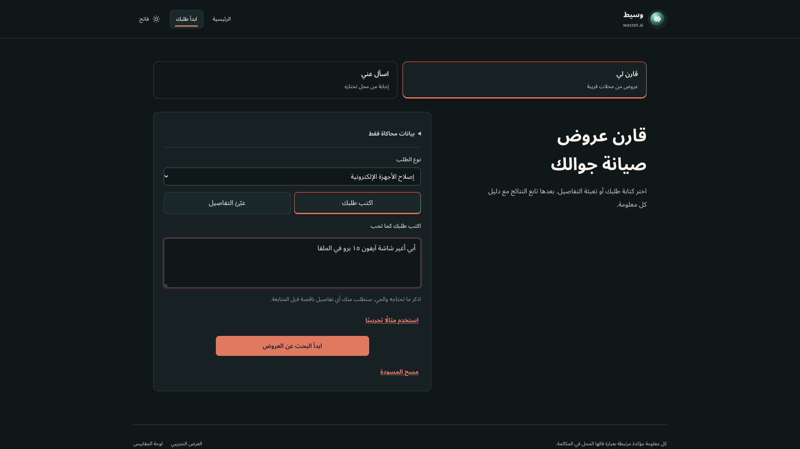
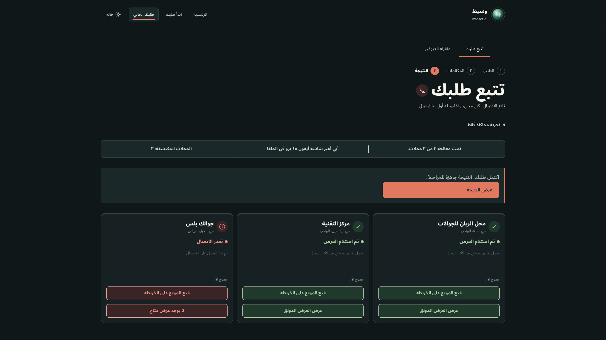
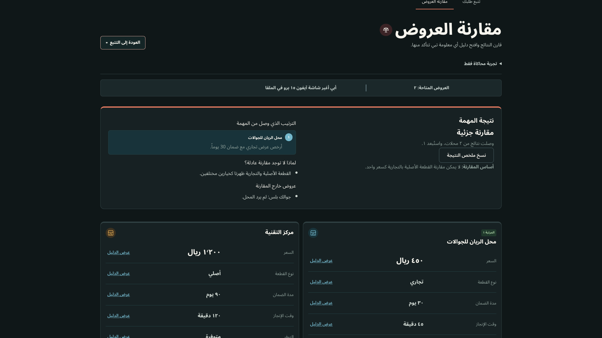
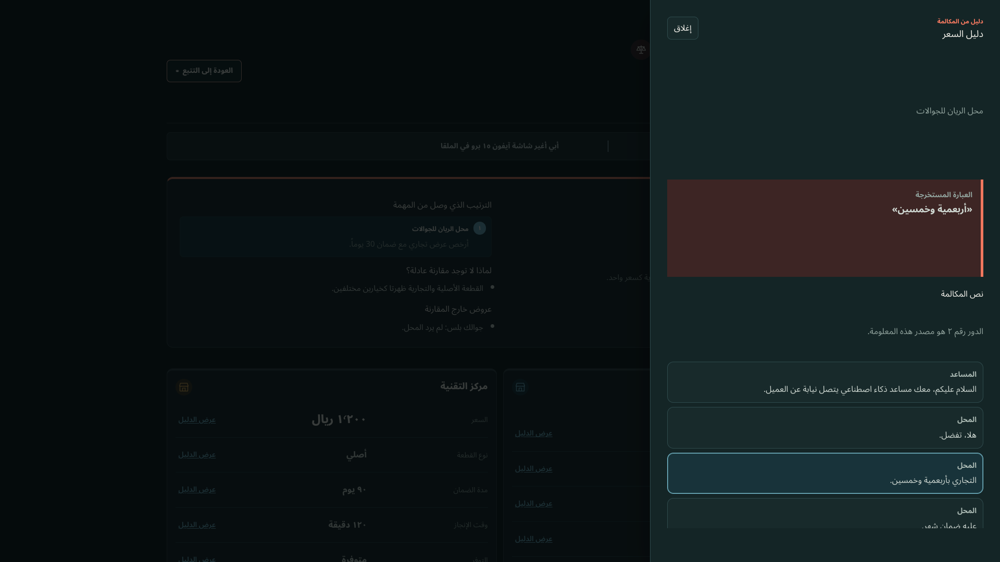
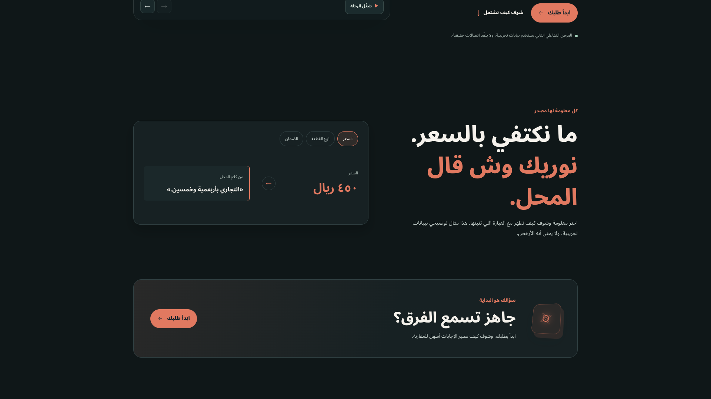

<p align="center">
  
</p>

<h3 align="center">Your AI agent that calls the shops, so you don't have to.</h3>

<p align="center" dir="rtl">قل وش تبي، ووسيط يتصل بالمحلات عنك ويجيب لك مقارنة واضحة.</p>

---

## Why wasset.ai

Getting a straight answer from local shops still means phone calls: call one, wait on hold, ask
the same questions again at the next one, and try to remember who said what. Prices are rarely
online, and when they are, they're often out of date.

**wasset.ai (وسيط, "the middleman") does the calling for you.** You describe what you need in
plain Saudi Arabic. An AI voice agent calls several nearby shops at the same time, asks each
one the same short questions, and gives you a side-by-side comparison. Every price, warranty
and promise in it links back to the exact words the shop said on the call.

## How it works

1. **Ask in your own words.** «أبي أغير شاشة آيفون ١٥ برو في الملقا» or «هل آيفون ١٦ متوفر قريب مني؟»
2. **It fills in the gaps.** It asks only what's missing (device, part, area) and finds shops nearby.
3. **It calls the shops in parallel.** A natural Saudi-dialect voice agent asks short, polite
   questions, adds one question of your own if you want, and says it is an AI if asked.
4. **You get one clear answer.** Offers are compared like for like (original vs. commercial
   parts, warranty, time). When two offers can't be fairly compared, it tells you why instead
   of guessing.

| | |
|---|---|
|  |  |
|  |  |
|  |  |

<sub>Screenshots from the web app in demo mode, with simulated shops and calls.</sub>

## What makes it different

- **Evidence, not guesses.** Each value in the comparison is tied to the sentence the shop
  said. Tap «عرض الدليل» to see it in the call transcript.
- **Fair comparisons.** It won't rank a 450 SAR commercial screen against a 1,200 SAR original
  as if they were the same thing.
- **Built for Saudi Arabia.** Saudi-dialect voice, Arabic-first right-to-left interface,
  English fallback.
- **Short, natural calls.** At most three questions, one at a time. Our live test call
  finished in under a minute.
- **Category templates.** Each kind of request (device repair and stock checks today, car
  repair next) is a template of questions and fields, so adding a category is mostly
  configuration, not new code.

## Use cases today

| | Example |
|---|---|
| **Repair quotes** | «كم تغيير شاشة آيفون ١٥ برو؟ أصلية ولا تجارية؟ كم الضمان؟» |
| **Stock checks** | «عندكم بلايستيشن ٥؟ كم سعره؟ جديد ولا مستعمل؟» |

## Architecture

```
web app (React, RTL)  ──►  FastAPI backend + live events (SSE)
                                   │
                         planner ──► orchestrator ──► up to 3 calls in parallel
                                                        │  (ElevenLabs voice agent + Twilio)
                                                        ▼
                                   evidence-checked extraction ──► like-for-like comparison
```

Every component talks through versioned JSON contracts (`contracts/`), so each piece can run
on a mock or a real provider. Details: [docs/architecture.md](docs/architecture.md).

## Project status

wasset.ai is an **MVP built in one month by a 7-person team** (KSU · Tuwaiq Club, AI track).

- **Done:** the full flow runs end to end (request → follow-up questions → parallel calls →
  evidence-backed quotes → comparison → live updates in the web app), with CI on every PR.
- **Built and tested, being connected:** the Twilio + ElevenLabs call provider, the Saudi voice
  agent, the evidence-checked extractor and comparator, and the evaluation tools. The demo app
  runs on simulated calls, so it is free to try and dials no real numbers.
- **Voice agent tested live** from the browser with a Saudi voice: a full quote call in under a
  minute. These were early tests, not a measured evaluation.
- **Privacy and disclosure:** the agent never denies being an AI, and call audio and
  transcripts are never stored in the repository. Tuwaiq's written AI-disclosure approval and
  the PDPL sign-off for recording and transcription are in progress.

## Roadmap

- **Live phone calls** to real shops through Twilio + ElevenLabs.
- **Live AI extraction and planning**, and real nearby-shop search (Google Places).
- **Quick Call (اسأل عني):** one question to one shop you choose
  ([ADR 002](docs/decisions/002-two-mode-product.md); preview in the web app).
- **Backup shops:** automatically call the next shop when one doesn't answer.
- **More categories:** car repair first, then any service where prices are given over the phone.
- **Accuracy measured on real calls**, and a cost cap per request.
- **Smarter location:** choose an area or use your current location.

## Run it locally

Python 3.11+ (we use 3.12).

```bash
python -m venv .venv
.venv\Scripts\activate                 # macOS/Linux: source .venv/bin/activate
pip install -r requirements-dev.txt
python -m pytest                       # all tests (CI runs the same)
python -m app.mocks.demo               # a full task on mocks: request -> 3 calls -> comparison
python -m app.mocks.demo --scenario one_failed
```

Web app (Node 20.19+; CI uses 26), against the demo backend:

```bash
python -m uvicorn app.api.main:app --port 8002   # terminal 1
cd web && npm ci && npx vite --port 5173         # terminal 2, then open http://localhost:5173
npm run lint && npm test && npm run build        # what CI runs for web/
```

Other scenarios: `all_failed`, `timeout`, `retry`, `provider_error`, `no_shops`.
`--json` prints only the events, one JSON object per line. Mocks make no network calls and
use fake phone numbers, so nothing costs money.

## Documentation

| | |
|---|---|
| Architecture, scope, privacy and evaluation | [docs/architecture.md](docs/architecture.md) |
| Python interfaces and backend wiring | [docs/integration.md](docs/integration.md) |
| Data contracts (JSON Schemas and examples) | [contracts/](contracts/README.md) |
| Design decisions | [docs/decisions/](docs/decisions/) |
| Delivery plan and milestones | [docs/mock-first-plan.md](docs/mock-first-plan.md) |
| Team roles, ownership and workflow | [docs/team-guide.md](docs/team-guide.md) |

## Team

Built by a 7-person team at King Saud University · Tuwaiq Club (AI track): planning and
orchestration, voice agent, speech and evaluation, telephony, backend and discovery,
extraction and comparison, and the web app. Roles and owners are in the
[team guide](docs/team-guide.md#roles-and-ownership).
