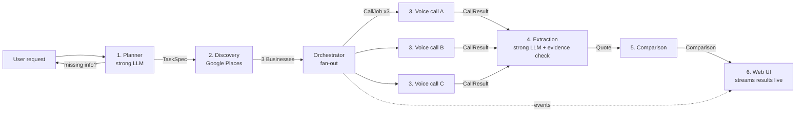

# Architecture — AI Voice Agent That Calls Shops and Compares Quotes

> **Read this whole file before you write any code.** It is the single source of truth for
> what we are building, how the parts fit together, and what each role owns.
> If you use Claude, Codex or any AI coding tool, give it this file first (see §12).

Team 2 · Tuwaiq Club AI Track · King Saud University
Lead: Rabeh · Feature freeze: **Sat 14 Nov 2026** (end of KSU Week 12) · Submission: **KSU Week 13 (Nov 15–21)** · Last updated: 22 Oct 2026

---

## 1. What we are building (one paragraph)

A user types a request like *"I want to replace my iPhone 15 Pro screen. Find 3 nearby
shops and ask about price, part type, warranty and repair time."* Our system asks any
missing questions, finds 3 nearby shops on Google Maps, **phones all 3 at the same time**
with an AI voice agent that speaks Saudi Arabic (and switches to English when staff
speak English), extracts the answers into structured fields **where every value is backed
by the exact words the shop said**, and shows a side-by-side comparison. If the answers
can't be compared fairly, it says so instead of guessing. Target: 3 quotes in about
3 minutes, versus 10–15 minutes calling by hand.

**What makes this more than a wrapper:** measured results. We report human reach rate,
task completion, critical-field accuracy, hallucination rate and cost per successful task
on a labelled set of 50–100 calls. Every claim in our demo is backed by a number.

## 2. Scope

| | In scope | Out of scope |
|---|---|---|
| Committed (the only one we promise) | **Electronics repair**: screens, batteries, charging ports | — |
| Stretch (only if electronics is stable, §10 Gate C) | **Car maintenance, standardized quotes only** (e.g. "2022 Camry front brake pads") | Open-ended diagnosis ("my car makes a noise") |
| Always | Asking questions, comparing answers | **Any action for the user**: bookings, reservations, payments, sharing personal info. Hospitals. **Hotels** (removed to protect time for evaluation and reliability). |

**Principle:** one reliable, well-evaluated electronics workflow beats three weak ones. If
time gets tight, we cut the stretch, never the evaluation.

**One engine, many templates.** Everything category-specific (planner questions, call
questions, fields, test scenarios) lives in a template file. Adding a category must not
require changing engine code.

## 3. The flow



1. **Planner** turns free text into a typed `TaskSpec`. If a required detail is missing
   (device model, car make/model/year, travel dates), it asks the user first. **No call is
   placed while required slots are empty.**
2. **Discovery** finds 3 open, relevant businesses with phone numbers (Places API).
3. **Calling**: one voice-agent call per business, in parallel. The agent says it is an AI
   assistant in its first sentence, asks the template's questions one at a time, and ends
   within ~2 minutes.
4. **Extraction** turns each transcript into a `Quote`. Every value has a status,
   confidence, and the evidence quote it came from. Code verifies that the quote really
   appears in what the shop said. **No quote → no value.**
5. **Comparison** ranks the shops, or returns `cannot_compare` with reasons.
6. **UI** shows each shop's result the moment its call ends (not after all 3).

## 4. Tech stack (decided unless marked)

| Layer | Choice | Notes |
|---|---|---|
| Voice agent platform | **ElevenLabs Agents** | $0.08/call-minute + LLM + carrier. Native Twilio integration, outbound calls, built-in end-call / language-detection / voicemail-detection tools. **Alternative:** Vapi or Retell if Arabic recognition fails our tests. Decided **after** we have a basic working call (§10 Gate B), not before |
| Speech recognition | ElevenLabs Scribe (inside ElevenLabs Agents) | ElevenLabs Agents only runs its own recognizer. Deepgram Nova-3 `ar-SA` is what we'd use **only if** we switch platform |
| Carrier | **Twilio**, foreign (US) number for the prototype | Saudi rates: ~$0.17/min landline, **~$0.31/min mobile**. Many shop numbers are mobiles: budget at the mobile rate |
| Live-call LLM | Fast model chosen in ElevenLabs config | A/B tested by R2 in KSU Week 11 |
| Planner + extraction LLM | Strong model via API | Structured (JSON) output |
| Backend | Python 3.11+, **FastAPI**, **Postgres** | One service. Simple job queue (decision by R5 early in KSU Week 10: Postgres-backed jobs or asyncio tasks) |
| Frontend | Small web app (React + Vite suggested) | Streams events from the backend (Server-Sent Events) |
| Discovery | **Google Places API (New) Text Search** | Requesting phone fields bills as the *Enterprise* tier: 1,000 free requests/month, then $35/1,000. Never request reviews/amenity fields (more expensive tier) |

## 5. Repository layout and ownership

Each folder has **one owner**. You may read everything; you only change your own folders.
`.github/CODEOWNERS` enforces this: PRs touching a folder need its owner's review.

```
/docs/architecture.md          this file                         R1
/docs/decisions/               decision records (ADRs)           R1 (anyone can propose)
/contracts/                    JSON Schemas of every contract    R1  ← change only via "contract change" PR
/contracts/examples/           one valid example per contract    R1  ← everyone builds against these
/templates/                    category templates (YAML)         R1 (fields with R6, questions with R2)
/app/planner/                  request → TaskSpec                R1
/app/orchestrator/             task state machine, fan-out       R1
/app/voice/   /prompts/        ElevenLabs agent config + prompts R2
/app/telephony/                Twilio, caller ID, retries, hours R4
/app/api/  /app/db/            FastAPI routes, Postgres          R5
/app/discovery/  /app/cache/   Places search, answer cache       R5
/app/extraction/               transcript → Quote + evidence     R6
/app/comparison/               Quotes → Comparison               R6
/eval/                         datasets, scenarios, metrics      R3
/web/                          frontend                          R7
/tests/<area>/                 tests, owned by the area's owner
```

**Never commit:** `.env` / API keys, call audio, transcripts of real people, SADA clips.
Put them in `/data/` (gitignored). Share **metrics**, not raw data.

## 6. Contracts (the most important section)

Parts talk to each other **only** through these shapes. Because they're fixed, every
role can build in parallel against the example files in `/contracts/examples/`
without waiting for anyone. **The schemas and example files in `/contracts/` are the source
of truth** (published Tue 27 Oct); the JSON below only illustrates them, and where the two
differ, the files win. Read `/contracts/README.md` first: it lists the conventions and the
rules a schema can't check (e.g. evidence must come from a shop turn).
Changing a contract = a PR labelled `contract-change`, approved by R1 and every role
that reads it.

### 6.1 `TaskSpec` — Planner → Discovery, Orchestrator
```json
{
  "task_id": "tsk_01",
  "category": "electronics_repair",
  "request_text": "أبي أغير شاشة آيفون 15 برو",
  "slots": { "device_model": "آيفون 15 برو", "repair_type": "الشاشة" },
  "area": { "label": "حي الملقا", "lat": 24.80, "lng": 46.61, "radius_m": 5000 },
  "max_businesses": 3,
  "missing_slots": [],
  "created_at": "2026-10-25T18:00:00Z"
}
```
Rule: if `missing_slots` is not empty, the planner returns follow-up questions instead.

### 6.2 `Business` — Discovery → Orchestrator
```jsonc
{
  "place_id": "ChIJ...", "name": "محل الريان للجوالات",
  "phone_e164": "+966501234567",
  "number_type": "mobile",          // mobile | landline | unified_920 | toll_free_800
  "address": "...", "maps_url": "https://maps.google.com/?cid=...",
  "open_now": true, "rating": 4.4
}
```

### 6.3 `CallJob` — Orchestrator → Voice/Telephony
```json
{
  "call_id": "call_01", "task_id": "tsk_01", "place_id": "ChIJ...",
  "to_number": "+966501234567", "template": "electronics_repair",
  "dynamic_variables": { "user_name": "رابح", "device_model": "آيفون 15 برو", "repair_type": "الشاشة" },
  "max_duration_s": 150, "attempt": 1
}
```

### 6.4 `CallResult` — Voice/Telephony → Extraction, Eval
```json
{
  "call_id": "call_01", "conversation_id": "conv_...",
  "outcome": "human_completed",
  "started_at": "...", "duration_s": 104, "language_final": "ar",
  "transcript": [
    { "i": 0, "speaker": "agent", "t": 0,  "text": "السلام عليكم، معك مساعد ذكاء اصطناعي..." },
    { "i": 1, "speaker": "shop",  "t": 6,  "text": "هلا، تفضل" },
    { "i": 2, "speaker": "shop",  "t": 21, "text": "الأصلي بألف ومتين، والتجاري بأربعمية وخمسين" }
  ],
  "cost_usd": 0.62, "pre_arranged": true, "scenario_id": null
}
```
`outcome` values: `human_completed` (all required fields), `human_partial`, `voicemail`,
`ivr`, `no_answer`, `busy`, `hung_up`, `wrong_business`, `failed`.
Note: ElevenLabs transcripts call the shop `user` and our agent `agent`. Convert to
`shop`/`agent` at the boundary so nobody confuses them.

### 6.5 `Quote` — Extraction → Comparison, UI
Every field uses the same **evidence-backed field** shape:
```json
{ "value": 450, "status": "found", "confidence": 0.9,
  "evidence_quote": "والتجاري بأربعمية وخمسين", "evidence_turn": 2 }
```
`status`: `found` | `not_mentioned` | `refused` ("تعال المحل ونشوف") | `unclear` (e.g. a wide range).
Rules: `value` is allowed **only** when `status = found` **and** `evidence_quote` is
non-empty **and** the quote is found in a **shop** turn.

Shops often quote two tiers in one breath, so a quote holds a **list of options**:
```json
{
  "call_id": "call_01", "place_id": "ChIJ...",
  "options": [
    { "part_type": { "value": "original",   "...": "..." },
      "price_sar": { "value": 1200, "...": "..." }, "warranty_days": { "status": "not_mentioned" } },
    { "part_type": { "value": "commercial", "...": "..." },
      "price_sar": { "value": 450,  "...": "..." }, "warranty_days": { "value": 30, "...": "..." } }
  ],
  "turnaround_minutes": { "...": "..." },
  "availability":       { "...": "..." },
  "evidence_issues": []
}
```
`part_type`: `original` (أصلي) · `pulled_original` (أصلي سحب) · `commercial` (تجاري / كوبي / high copy) · `unknown`.

### 6.6 `Comparison` — Comparison → UI
```jsonc
{
  "task_id": "tsk_01",
  "status": "ranked",                  // ranked | partial | cannot_compare
  "basis": "commercial screen, price incl. warranty",
  "ranking": [ { "place_id": "...", "rank": 1, "reason": "cheapest commercial, 30-day warranty" } ],
  "excluded": [ { "place_id": "...", "reason": "refused to quote by phone" } ],
  "cannot_compare_reasons": []
}
```

### 6.7 Events — Backend → UI (Server-Sent Events, in order)
`task.created` → `task.needs_input` → `business.found` (×3) → `call.started` →
`call.ended` → `quote.ready` → … → `comparison.ready` · plus `call.failed`, `task.failed`.
Each event: `{ "type", "task_id", "at", "data": <the contract above> }`.

## 7. Category template format

`/templates/electronics_repair.yaml` (owner R1; questions R2; fields R6):
```yaml
category: electronics_repair
planner_questions:            # asked to the USER before calling
  - { key: device_model, ask_ar: "وش نوع الجهاز وموديله بالضبط؟" }
  - { key: repair_type,  ask_ar: "وش تبي تصلّح؟ الشاشة، البطارية، ولا منفذ الشحن؟" }
  - { key: area,         ask_ar: "وين تبي المحلات تكون؟" }
call_questions:               # asked by the AGENT on the call, one at a time
  - { field: price_sar,          ask_ar: "كم سعر تغيير {{repair_type}} لـ {{device_model}}؟" }
  - { field: part_type,          ask_ar: "القطعة أصلية ولا تجارية؟ وإذا عندكم النوعين، كم سعر كل وحدة؟" }
  - { field: warranty_days,      ask_ar: "فيه ضمان؟ وكم مدته؟" }
  - { field: turnaround_minutes, ask_ar: "كم ياخذ وقت التصليح تقريبًا؟" }
  - { field: availability,       ask_ar: "القطعة متوفرة الحين ولا تحتاجون تطلبونها؟" }
required_fields: [price_sar, part_type, warranty_days, turnaround_minutes]
compare_on: [part_type, price_sar, warranty_days]   # like-for-like comparison basis
asr_keywords: [أصلي, تجاري, سحب, ضمان, شاشة, بطارية, آيفون, iPhone, Samsung]
places_queries: { ar: [صيانة جوالات], en: [phone repair shop] }
```
Car maintenance fields (stretch only): `price_sar`, `part_brand` (original / aftermarket),
`labor_included`, `warranty_days`, `turnaround_minutes`.

## 8. Roles

7 roles, each with one owner and one backup. The backup reviews the owner's PRs and can
demo their part if the owner is absent.

**How to pick:** read R2–R7 below, then reply in the group with your **1st and 2nd choice**. If two people want the same role, we'll agree together, and second choices fill the rest. Backups are assigned after.

| Role | Name | Backup |
|---|---|---|
| R1 Tech lead, planner, orchestrator | Rabeh | R5 |
| R2 Voice agent | _____ | R4 |
| R3 Speech recognition + evaluation | _____ | R6 |
| R4 Telephony | _____ | R2 |
| R5 Backend + discovery | _____ | R1 |
| R6 Extraction + comparison | _____ | R3 |
| R7 Frontend, evidence view, demo | _____ | R5 |

---

### R1 — Tech lead, planner, orchestrator
**Taken by Rabeh.** Glue work: contracts, planning, running the parallel calls, and integrating everyone's parts every Thursday.
**Mission:** keep the parts connected; own the contracts; turn requests into tasks and tasks into parallel calls.
**Owns:** `/contracts`, `/templates`, `/app/planner`, `/app/orchestrator`, `/docs`.
**Builds:**
- All JSON Schemas + example files (§6): drafted in Week 9 if convenient, **published by Mon 26 Oct** so every role can build in parallel.
- **Planner:** request text → `TaskSpec` with a strong LLM in JSON mode; returns follow-up questions from the template when slots are missing; refuses out-of-scope requests (booking, hospitals, open diagnosis) with a clear message.
- **Orchestrator:** task state machine (`created → needs_input → discovering → calling → extracting → done | failed`), launches up to 3 calls in parallel, emits events (§6.7), retries per R4's rules, stops a task that runs over budget or time.
- Decision records in `/docs/decisions/` (voice platform, queue, car-stretch go/no-go).
**First milestone (Week 10, Thu 29 Oct):** request → `TaskSpec` → one controlled call → transcript back (§10 Gate A).
**Done when:** a request runs end-to-end on fixtures (no real calls) and the UI receives every event in order.
**Not your job:** writing other roles' code. Review it, unblock it, integrate it.

### R2 — Voice agent
**Pick this if:** you like prompt engineering and want to hear your work. You'll spend most of your time tuning how the agent sounds, asks and reacts, then testing it on real phone calls.
**Mission:** a polite, short, honest phone call in Saudi Arabic that gets the answers.
**Owns:** `/app/voice`, `/prompts`.
**Builds:**
- Agent configuration **as code**: prompt, first message, voice, LLM, tools, max duration, all in the repo, pushed to ElevenLabs by a script. Never edit only in the dashboard.
- Call flow: disclosure → questions one at a time → one clarification per unclear answer → repeat the price back to confirm → polite end. Refuse bookings and personal info.
- English switching (language-detection tool + an English first message), voicemail/IVR detection → hang up, no message left.
- Pick the voice (Saudi dialect, natural on an 8 kHz phone line) and A/B 2–3 fast LLMs on the same scenarios.
- Accepts a `CallJob`, returns a `CallResult` (with R4).
**Done when:** 10 role-play calls in a row disclose AI in the first sentence, finish under 2.5 min, and never agree to a booking.
**Watch out:** the first sentence **must** say it's an AI assistant calling on behalf of the user. Add an automated test that fails if the first message stops saying this.

### R3 — Speech recognition + evaluation harness
**Pick this if:** you like data, experiments and measuring things more than building features. You'll run the speech-recognition test that picks our platform, then build the test sets and metrics that turn our demo into real results.
**Mission:** prove with numbers whether the system works.
**Owns:** `/eval`.
**Builds:**
- **Speech benchmark (run Sun–Tue 1–3 Nov in Week 11, after the first working call; nobody is blocked on it):** ~30 clips = ~20 from SADA + ~10 recorded over real Twilio calls of teammates reading shop-style answers (prices, "أصلي/تجاري", English mixed in). Compare **ElevenLabs Scribe** vs **Deepgram Nova-3 `ar-SA`**.
  - SADA is TV-broadcast audio. Make it phone-like: band-limit to ~300–3400 Hz, resample to 8 kHz, pass through the μ-law phone codec. Downsampling alone is too clean.
  - Score **number accuracy** separately from word error rate. Getting the price right matters more than spelling.
  - SADA licence is CC BY-NC-SA 4.0: OK for our non-commercial evaluation, cite it, don't commit the clips.
  - The result feeds the voice-stack decision (§10 Gate B) together with R2/R4's real test calls.
  - Week 10 prep: download SADA, write the phone-simulation script, draft scenario cards, record ~10 clips over the first Twilio calls.
- Arabic text normalization + number parsing shared by everyone (e.g. "ثلاثمية وخمسين" = 350, "٤٥٠" = 450).
- **Scenario cards:** role-play scripts with hidden ground truth (cooperative shop, English-speaking expat, "come to the shop" refusal, hold/busy, price range, asks for your number, mixed Arabic/English).
- **Fake shopkeeper:** an LLM playing a scenario card in text mode, for hundreds of cheap logic tests of the call flow + extraction.
- Metrics script (§9) that reads `CallResult` + `Quote` + labels and prints the headline table.
**Done when:** one command produces the §9 table from the labelled call set.

### R4 — Telephony (biggest real-world risk)
**Pick this if:** you enjoy solving messy real-world problems and talking to providers. Less ML, more systems: carriers, caller ID, voicemail and phone menus, retries. If this part fails, nothing reaches a real shop, so it's high impact.
**Mission:** make real phone calls reach real people in Saudi Arabia.
**Owns:** `/app/telephony`.
**Builds / tests:**
- Twilio **paid** account (trial accounts only call verified numbers and play a trial message), Saudi Arabia enabled in voice geographic permissions, US number, connected to ElevenLabs.
- **Caller-ID test (10 min):** try showing our own Saudi number via Twilio Verified Caller ID. Does the call connect? What does the receiver see? Write down the result.
- **Reach-rate reality:** shopkeepers often ignore unknown international numbers. Log `pre_arranged` on every call; we report reach rate for pre-arranged and cold calls **separately**.
- Number types: mobile / landline / 920 (usually a phone menu) / 800. Hold music, IVR menus, voicemail, busy, no answer → correct `outcome`.
- Retry policy (max 1 retry after 10 min, never more), calling hours (normal shop hours; avoid prayer times and Friday morning), callbacks to our number logged to the right task.
- **Production path research:** email Unifonic. Their public voice API shows one-way calls (play a message), but they list SIP trunking with Saudi caller ID. Ask exactly: *"Can you provide an outbound SIP trunk with a Saudi caller ID that we connect to ElevenLabs Agents?"* Also check Saudi SIP options (Zain/STC/Mobily need a commercial registration).
**Done when:** `docs/telephony.md` records every test with result + date, and every call gets a correct `outcome`.
**Demo fallback only (not the product):** Rabeh calls a shop from his phone and merges in the agent's number.

### R5 — Backend + discovery
**Pick this if:** you want solid software engineering: APIs, databases, external APIs, caching. You'll build the service everything runs through, plus the Google Places search that finds the shops.
**Mission:** the service that stores everything and serves the UI.
**Owns:** `/app/api`, `/app/db`, `/app/discovery`, `/app/cache`.
**Builds:**
- FastAPI endpoints:
  - `POST /tasks` (request text) → `{task_id, follow_up_questions}`
  - `POST /tasks/{id}/answers`
  - `POST /tasks/{id}/start`
  - `GET /tasks/{id}` (full state)
  - `GET /tasks/{id}/events` (SSE stream)
  - `POST /webhooks/elevenlabs/post-call` (optional; polling the conversation API also works and is easier locally)
- Postgres tables: `tasks`, `businesses`, `calls`, `quotes`, `comparisons`, `events`, `labels` (for eval).
- **Places discovery:** Text Search with a strict field mask (id, name, address, location, phones, opening hours, rating, Maps link; **no reviews**), `regionCode=SA`, `openNow`, location bias. Pick 3: open now, has a phone, relevant, prefer landline/mobile over 920.
- **Cache:** don't call the same shop for the same question within N days; reuse the stored quote and label it "from <date>".
- Cost record per call (platform + LLM + carrier) for the cost metric.
**Done when:** the orchestrator can run a whole task against the real DB with fixture calls, and Places returns 3 callable shops for 3 Riyadh districts.

### R6 — Extraction + comparison
**Pick this if:** you like LLMs and want the most "AI engineering" part of the project. You'll turn messy Arabic transcripts into reliable structured data and build the check that stops the AI from inventing values.
**Mission:** turn transcripts into trustworthy numbers, and compare only what is comparable.
**Owns:** `/app/extraction`, `/app/comparison`.
**Builds:**
- **Extraction:** `CallResult` → `Quote` with a strong LLM in JSON mode, following §6.5 exactly. Convert units (3 months → 90 days, 1 hour → 60 min) while keeping the original words as evidence.
- **Evidence checker (code, not prompt):** for every value, check the quote exists in a **shop** turn (whole-word match after Arabic normalization) and, for prices, that the number is actually in the quote. Failures go to `evidence_issues` and the value is dropped. This is how "no invented values" is enforced. The agent repeating a price back does **not** count as evidence.
- **Comparison:** compare like with like (same `part_type`). Return `cannot_compare` with reasons when key fields are missing, refused, or inconsistent (e.g. shop A only gave an original price, shop B only commercial).
- **Baseline experiment:** ElevenLabs' built-in "data collection" gives values without verified evidence. Run both on the same calls and compare hallucination rates. This is one of our strongest results.
**Done when:** on the fixture transcripts, every value has valid evidence, and the comparison returns `cannot_compare` for the mismatched fixture.
**Watch out:** LLM confidence scores are poorly calibrated. Treat them as secondary; the evidence check is the real guard.

### R7 — Frontend, evidence view, observability, demo
**Pick this if:** you like UI/UX and presenting. You'll build what everyone sees: the live 3-shop view, the evidence display and the metrics dashboard, and you'll own the final demo.
**Mission:** make it obvious, in 10 seconds, what the system found and why we trust it.
**Owns:** `/web`.
**Builds:**
- Request box → follow-up questions → live view of 3 shop cards (searching → ringing → talking → done/failed) driven by the SSE events.
- Each field shows its value **and** its evidence quote (tap to see the transcript turn). Clear "can't compare" state with reasons.
- Internal dashboard: reach rate, completion, cost, latency per call (from R3's metrics + R5's data).
- Demo: script, a recorded backup video, and a live call to a pre-arranged shop.
**Done when:** a full task on fixtures plays through the UI with no manual refresh.
**Rule:** never show a real worker's voice or name publicly without consent. Use role-play recordings in the demo video.

---

## 9. Evaluation (how we prove it works)

| Metric | Definition |
|---|---|
| **Human reach rate** | calls with outcome `human_*` ÷ all attempts. Report pre-arranged vs cold separately |
| **Task completion** | `human_completed` ÷ calls that reached a human |
| **Critical-field accuracy** | correct values ÷ labelled values, for price, part type, warranty, time (per field and overall) |
| **Hallucination rate** | values not supported by the transcript ÷ all values returned. Ours vs the ElevenLabs built-in baseline |
| **Cost per successful task** | total cost ÷ tasks where ≥2 of 3 shops gave usable quotes |
| Also logged | turn latency, language-switch success, failure types, total time per request |

**Datasets:** (1) role-play calls over real phone lines using scenario cards (we know the
truth); (2) consenting real shops; (3) pilot calls after approval; (4) fake-shopkeeper text
simulations; (5) SADA phone-simulated clips for the Week 11 speech benchmark.
**Targets:** ~30 speech clips by Tue 3 Nov; **at least 50 fully labelled calls** by the feature
freeze (Sat 14 Nov), 100 if time allows. Labelling starts with the first role-play calls in
Week 11 and runs continuously, never saved for the end. Fake-shopkeeper text tests cover
the long tail cheaply.
**Labels:** two people label each call independently, then resolve disagreements.

## 10. Plan, gates and integration rhythm

**Deadline: submission in KSU Week 13 (Nov 15–21).** The exact submission day is confirmed
with the AI track leader; we aim to be **submission-ready by Wed 18 Nov** either way.

**Principle:** Week 9 is light setup only. Week 10 proves one minimal working call while
every other role builds against the contracts. Weeks 11–12 bring the full system together.
Week 13 is finalization only. The scope stays the same; what makes it fit is **parallel work
from fixed contracts**, not cutting features and not compressing two weeks into one.

**Rhythm:** weeks run Sunday–Thursday. **Every Thursday (29 Oct, 5 Nov, 12 Nov): integration
demo**: whatever is merged to `main` must run end-to-end (fixtures are fine early on). If your
part isn't merged, it doesn't exist yet. Blocked for more than a day → tell R1 that day.

### Overview

| KSU week | Dates | Goal |
|---|---|---|
| **9** | Oct 18–24 | **Light setup only:** roles, repo, architecture read-through, account/API requests if convenient |
| **10** | Oct 25–31 | **Minimal working call:** user request → `TaskSpec` → one controlled call → transcript returned. All other roles start their components against fixtures |
| **11** | Nov 1–7 | **Core components come together:** discovery + backend, full voice flow, telephony outcomes, extraction + evidence on real transcripts, live UI; from one call to 3 parallel calls; speech benchmark |
| **12** | Nov 8–14 | **Full integration:** 3 parallel calls → extraction → evidence check → comparison / can't-compare → live UI; evaluation runs on ≥50 labelled calls; reliability fixes. **Feature freeze Sat 14 Nov** |
| **13** | Nov 15–21 | **Submission:** final metrics, README, architecture diagram, presentation, live demo + recorded fallback, bug fixes only |

### Week 9 (Oct 18–24): light setup only

The only goal: **nobody is confused about what we are building or what they own.**
- Final roles assigned (done); repo created; everyone added to GitHub
- Everyone reads this file and their own role section, and asks questions in the group
- Account/API requests submitted **if convenient** (Twilio, ElevenLabs, Google Maps, LLM API)
- R1, only if convenient: repo folders, contract drafts, and send the Tuwaiq/KSU sign-off request (§11), because real-shop calls in Week 12 depend on it

**Not required this week:** no coding deadline, no group technical session, no Twilio setup,
no speech benchmark, no end-to-end call.

### Per-role plan (Weeks 10–12)

Each cell is that role's deliverable for the Thursday demo. Every role can start on Sunday
26 Oct from the contracts and §6 examples, without waiting for anyone.

| Role | Week 10 (Oct 25–31) | Week 11 (Nov 1–7) | Week 12 (Nov 8–14) |
|---|---|---|---|
| **R1** | Contracts + examples published Mon 26 Oct; planner v0 (request → `TaskSpec` + follow-up questions); wires the minimal flow (**Gate A**) | Orchestrator state machine + events; fan-out from 1 to 3 calls; runs **Gate B** | Full pipeline with 3 real parallel calls; integration fixes; **Gate C**; freeze |
| **R2** | Agent as code (prompt, first message, Saudi voice, tools) pushed by script; tested in browser, then on a teammate's phone | Full call flow; English switching; voicemail/IVR → hang up; LLM A/B; 10–20 role-play calls using R3's scenario cards | Fix the top voice failures found in labelled calls; consented real-shop calls (after sign-off) |
| **R3** | Arabic normalization + number parser; SADA phone-simulation script; ≥6 scenario cards; ~10 clips recorded over the first Twilio calls | **Speech benchmark Sun–Tue (Gate B input)**; label role-play calls as they happen; fake-shopkeeper text tests; metrics script v0 | ≥50 labelled calls; full metrics table incl. ours vs ElevenLabs baseline; failure-type breakdown |
| **R4** | Paid Twilio, Saudi permissions, number connected to ElevenLabs, allowlist enforced; places the Gate A call; caller-ID test | Correct `outcome` for voicemail / IVR / busy / no answer; retry policy + calling hours; Unifonic emailed; `docs/telephony.md` | Reliability under 3 parallel calls; reach rate pre-arranged vs cold (if signed off) |
| **R5** | FastAPI skeleton + Postgres tables; stores `TaskSpec`, call and transcript (Gate A); queue decision; Places script returns callable shops | Places discovery in the pipeline (pick 3); SSE events endpoint; cost per call; cache | Robustness, logging, cost/latency data for the dashboard |
| **R6** | Extraction v0 on the §6.4 example transcripts → `Quote`; evidence checker with unit tests | Extraction on real role-play transcripts; comparison + `cannot_compare`; ElevenLabs baseline stored for comparison | Fix evidence failures; price ranges; hallucination numbers ours vs baseline |
| **R7** | Web skeleton: request box, follow-up questions, 3 shop cards driven by fake events | Live view on real SSE events; evidence display (value + quote + transcript turn) | Metrics dashboard; demo script; **first take of the recorded fallback** |

### Week 13 (Nov 15–21): submission and finalization

Code is frozen. Final metrics run on the frozen version; README; architecture diagram;
presentation; demo rehearsal; live call to a pre-arranged shop **plus the final recorded
fallback video**; bug fixes only, no new features.

### Gates (decisions with numbers, recorded in `/docs/decisions/`)

- **Gate A, Thu 29 Oct → "we can make a call":** one controlled call completes and its transcript is stored against a `TaskSpec`. If it fails, R1/R2/R4/R5 fix it first thing Sunday 1 Nov; everyone else keeps building on fixtures.
- **Gate B, Tue 3 Nov → voice stack:** stay on ElevenLabs if the real test calls work and Scribe's number accuracy on phone-quality clips is acceptable. Otherwise switch to Vapi/Retell with Deepgram `ar-SA`, after confirming that platform actually accepts `ar-SA` (one Vapi support thread showed it rejected). With this calendar, any switch must be decided by Tue 3 Nov, and only on clear evidence; after that date the stack is final.
- **Gate C, Thu 12 Nov → car stretch:** only if the full electronics workflow runs end-to-end and, on the labelled calls, critical-field accuracy is ≥ 85% and hallucination ≤ 2% (team confirms the exact bar in Week 11). Cars = a new template + scenario cards only, no engine changes, added only by someone whose own part is done, before the freeze. Otherwise cars are listed as future work in the README.
- **Feature freeze, Sat 14 Nov:** after this, only bug fixes.

## 11. Ethics, privacy, safety (non-negotiable)

- The agent **always** says it is an AI assistant in its first sentence and never pretends to be human.
- Weeks 10–11 (and until sign-off): calls only to an **allowlist** of numbers whose owners agreed (friends, teammates, shops we know). Code must refuse any number not on it.
- Saudi PDPL applies to recording and transcribing calls. Get **Tuwaiq/KSU sign-off** on disclosure, consent and retention **before** calling real businesses at scale.
- Keep recordings/transcripts only as long as evaluation needs (e.g. 30 days). Never in git.
- Call only during normal hours; at most one retry; cache answers so we don't pester shops.
- No bookings, no personal data shared, no actions for the user.

## 12. How to work (with or without AI tools)

**Using Claude / Codex / any AI coding tool:**
1. Give it this whole file plus your role section, and say: *"Build only inside my folders
   (`…`). Use the contracts in `/contracts/` exactly. Use the example files as test data.
   Don't change contracts or other folders."*
2. Ask it to explain the plan before writing code, and to write tests.
3. **You must understand every line you push.** Your backup will ask you to explain it in
   review, and you'll present it in the demo. Ask the AI to walk you through anything you don't get.

**Pull requests:**
- Small PRs, one topic each. Branch name: `r<role>/<topic>` (e.g. `r4/caller-id-test`).
- Every PR description has **What**, **Why**, and **How I verified** (paste the command and its output, or a screenshot).
- Your backup reviews. Contract changes also need R1.
- CI (lint + tests) must pass. No secrets, no recordings, no real people's data.

**Status:** every Thursday before the demo, post 3 lines in the group: *done / next / blocked by.*
Blocked for more than a day → tell R1 immediately, don't wait for Thursday.

## 13. Open questions (owner → due)

- Approval from the AI track leader + exact submission day in Week 13: share this file now; show the first recorded test call after Gate A (29 Oct) → R1.
- Tuwaiq/KSU sign-off on disclosure, consent, retention → R1, request in Week 9; needed before any real-shop calls (Week 12).
- Which API subscriptions Tuwaiq covers vs our $500–1k budget → R1, Week 9 if convenient, at latest Sun 25 Oct.
- Can Unifonic (or a Saudi SIP provider) carry a live two-way AI call with a Saudi caller ID? → R4, Week 11.
- How to represent price ranges ("من ٣٠٠ لين ٥٠٠") → R6, Week 11.

## 14. Glossary

- **Contract:** the agreed JSON shape one part hands to another (§6).
- **Fixture / example file:** a fake but valid contract instance you build and test against.
- **Evidence quote:** the shop's exact words that support a value.
- **Pre-arranged call:** the shop agreed in advance; reported separately from cold calls.
- **SIP trunk:** a carrier connection that lets our voice platform make calls with a local number.
- **IVR:** an automated phone menu ("press 1 for…").
- **ADR:** a short decision record: context, options, decision, why.
