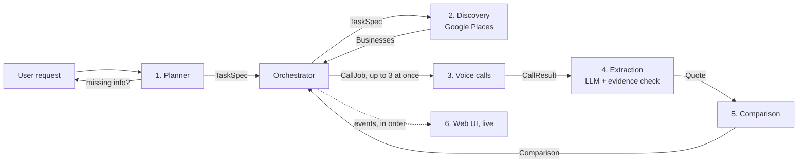

# Architecture

What we are building, how the parts fit, who owns what, and the rules that don't change.
Current deadlines and deliverables live in [mock-first-plan.md](mock-first-plan.md); Python
interfaces in [integration.md](integration.md); data formats in [`/contracts`](../contracts/README.md).

Team 2 · Tuwaiq Club AI Track · King Saud University · Lead: Rabeh (R1)

## 1. Problem and solution

Getting a repair quote or checking stock means phoning several shops, asking the same
questions, and comparing vague answers. It takes 10–15 minutes and the answers are hard to
compare.

A user types a request (*"أبي أغير شاشة آيفون 15 برو"*, *"عندكم آيفون 16؟"*) and may add up
to 2 questions of their own. The system asks for anything missing, finds nearby shops on
Google Places, **phones them at the same time** with a voice agent that speaks Saudi Arabic
(English when staff do), and turns each call into structured fields **where every value is
backed by the shop's exact words**. It answers the user's own questions with a short summary
plus quotes, and compares the shops, or says plainly that they can't be compared fairly.
Target: 3 quotes in about 3 minutes.

**What makes it more than a wrapper:** measured results on labelled calls (§8). Every claim
in the demo is backed by a number.

## 2. Scope

| | In scope | Out of scope |
|---|---|---|
| **Committed** | **Electronics repair quotes** (screens, batteries, charging ports) and **stock checks** ("عندكم آيفون 16؟", "MacBook Air M4؟": available, price, new or used) | — |
| **Stretch** (only if Gate C passes) | **Car repair, standardized requests only** (brake pads, tires, lights) | Open-ended diagnosis ("my car makes a noise") |
| **Always** | Asking questions, comparing answers, up to 2 user-written questions per task | **Any action for the user**: bookings, reservations, payments, sharing personal data. Hospitals, hotels |

- A few reliable, well-evaluated workflows beat many weak ones. If time gets tight, we cut
  the stretch, never the evaluation.
- **One engine, many templates.** Everything category-specific lives in `/templates/*.yaml`.
  A new category is a YAML file plus scenario cards, with no engine change.

## 3. How it works

1. **Planner** turns the request into a typed `TaskSpec`, asking follow-up questions from the
   template when details are missing. It refuses out-of-scope requests, and refuses custom
   questions or answers that would make the agent book, pay or share personal data.
   **No call is placed while required details are missing.**
2. **Discovery** finds open, relevant shops with phone numbers.
3. **Calling:** one call per shop, **up to 3 at the same time**, each under ~2.5 minutes. The
   agent asks the template's questions, then the user's own questions, one at a time. It
   does not announce that it is an AI, and never denies it when asked (§9).
4. **Extraction** turns each transcript into a `Quote`. Code checks that every value's evidence
   quote really appears in a **shop** turn. **No quote, no value.**
5. **Comparison** ranks shops like for like, or returns `cannot_compare` with reasons.
6. **UI** shows each shop's result the moment its call ends, from a stream of ordered events.

**Status today:** R1's planner, orchestrator and contract validation are implemented and
tested. Every external service runs as a **mock** (`app/mocks/`) until the API keys arrive.
Real discovery, calling, extraction, comparison, backend and UI are being built by R2–R7.
What is blocked and when: [mock-first-plan.md](mock-first-plan.md).

## 4. Design decisions

- **Contracts are the interfaces.** Parts exchange only the JSON shapes in `/contracts`, so
  every role builds and tests in parallel against `contracts/examples/`. Changing one needs a
  `contract-change` PR ([contracts/README.md](../contracts/README.md)).
- **Every external service sits behind a small Python interface** taking and returning
  contract objects. Mocks and real providers are swapped in one place, the backend's startup
  wiring, so nobody edits the planner or orchestrator to integrate.
- **Evidence over confidence.** LLM confidence scores are poorly calibrated, so the code-level
  evidence check is the real guard against invented values.
- **An attempted call is not a usable quote.** Reaching a person (`human_*` outcome) is
  measured separately from getting a quote that is usable for the category.
- **One process, asyncio, no queue.** The orchestrator runs tasks as asyncio tasks inside the
  backend process. Simple and enough for a prototype; the limits are in §10.
- **The orchestrator numbers events** (1, 2, 3… per task, no gaps); the backend stores them and
  streams them over Server-Sent Events (SSE), replaying on reconnect.
- **Today: at most 3 shops per task.** *Approved future direction, not implemented:* discover
  ~6 candidates, keep at most 3 calls running, and replace a shop that gives no usable quote
  with the next candidate, until 3 verified usable quotes or a limit (attempts, time, cost)
  is reached. Usability rules per category come from R6. This needs a contract proposal
  first (§10).

## 5. Tech stack

| Layer | Choice | Notes |
|---|---|---|
| Voice agent | **ElevenLabs Agents** | $0.08/call-minute + LLM + carrier. Native Twilio, outbound calls, end-call / language-detection / voicemail-detection tools. Default unless real tests justify switching (Gate B in the plan). Alternative: Vapi or Retell, only after confirming they accept `ar-SA` |
| Speech recognition | ElevenLabs Scribe (built in) | ElevenLabs runs only its own recognizer. Deepgram Nova-3 `ar-SA` only if we switch platform |
| Carrier | **Twilio**, US number for the prototype | Saudi rates ~$0.17/min landline, **~$0.31/min mobile**; budget at the mobile rate |
| Live-call LLM | Fast model in the ElevenLabs config | A/B tested by R2 |
| Planner + extraction LLM | Strong model via API, JSON output | Planner runs on a deterministic mock parser until a key arrives |
| Backend | Python 3.11+, **FastAPI**, **Postgres** | One process; tasks run as asyncio tasks |
| Frontend | Small web app (React + Vite suggested) | Live updates via SSE |
| Discovery | **Google Places API (New) Text Search** | Phone fields bill at the Enterprise tier: 1,000 free requests/month, then $35/1,000. Never request reviews or amenity fields |

Total spend stays under **$500**.

## 6. Components and ownership

Each folder has one owner. Read anything; change only your own folders. A PR is reviewed by
the folder's owner or backup.

| Role | Owner | GitHub | Backup | Folders |
|---|---|---|---|---|
| R1 Tech lead, planner, orchestrator | Rabeh | @rabehalmutairi | R5 | `app/planner/`, `app/orchestrator/`, `app/mocks/`, `app/contracts.py`, `contracts/`, `templates/` (fields with R6, questions with R2), `docs/`, `.github/` |
| R2 Voice agent | Abdulmalik | @abdulmaliksd955 | R4 | `app/voice/`, `prompts/` |
| R3 Speech recognition + evaluation | Feras | @FerasMad | R6 | `eval/` |
| R4 Telephony | Saleh Alrakban | @Salehalrakban | R2 | `app/telephony/` |
| R5 Backend + discovery | Omar | @EviLooo | R1 | `app/api/`, `app/db/`, `app/discovery/`, `app/cache/` |
| R6 Extraction + comparison | Ahmed | @Ahmed-Aw | R3 | `app/extraction/`, `app/comparison/` |
| R7 Frontend, evidence view, demo | Saleh Aljarwan | @CsSaleh17 | R5 | `web/` |

Tests live in `tests/<area>/`, owned by the area's owner. **Never commit** `.env`, API keys,
call audio, transcripts of real people or SADA clips; keep them in `data/` (gitignored).

What each component must do (current deliverables and dates are in the plan):

- **R1 planner + orchestrator.** Request → `TaskSpec` with follow-up questions; task state
  machine `created → needs_input → discovering → calling → extracting → done | failed`; up to
  3 concurrent calls; retries only as R4's policy decides (max one); timeouts, cancellation,
  cost cap; ordered events. *Done when* a request runs end to end on fixtures and the UI
  receives every event in order.
- **R2 voice agent.** Agent configuration **as code** (prompt, first message, voice, LLM,
  tools, max duration) pushed by a script, never edited only in the dashboard. Call flow:
  greeting → template questions one at a time → the user's questions → one clarification per
  unclear answer → repeat the price back → polite end. Refuse bookings and personal data
  whatever the call variables say. English switching; voicemail/IVR → hang up, leave no
  message. Pick a Saudi voice that sounds natural on an 8 kHz line; A/B 2–3 fast LLMs.
  *Done when* 10 role-play calls in a row finish under 2.5 min, ask every question, and never
  accept a booking. A scenario test where the shop asks "إنت روبوت؟" fails if the agent denies being an AI.
- **R3 speech recognition + evaluation.** Speech benchmark: ~30 clips (~20 SADA, ~10 over real
  calls) comparing Scribe and Deepgram `ar-SA`. Make SADA phone-like (band-limit 300–3400 Hz,
  8 kHz, μ-law), score **number accuracy** separately from word error rate; SADA is CC BY-NC-SA
  4.0 (cite it, never commit clips). Also: shared Arabic normalization and number parsing
  ("ثلاثمية وخمسين" = 350), scenario cards with hidden ground truth, a fake-shopkeeper text
  simulator, and the metrics script. *Done when* one command prints the §8 table.
- **R4 telephony.** Paid Twilio account (trial accounts can't call unverified numbers), Saudi
  Arabia enabled, connected to ElevenLabs. Caller-ID test with our Saudi number. Correct
  `outcome` for every number type and failure (920 numbers usually hit a menu). Allowlist
  enforced in code. Retry policy: max one retry after 10 minutes, normal shop hours only,
  avoiding prayer times and Friday morning. Log `pre_arranged` on every call, and log call-backs to our number against the right task. Ask Unifonic: *"Can you provide
  an outbound SIP trunk with a Saudi caller ID that we connect to ElevenLabs Agents?"*
  (Saudi carriers' SIP needs a commercial registration.) *Done when* `docs/telephony.md` records every test with its result and date. Demo fallback
  only: R1 calls a shop from his phone and merges in the agent's number.
- **R5 backend + discovery.** FastAPI routes: `POST /tasks`, `POST /tasks/{id}/answers`,
  `POST /tasks/{id}/start`, `GET /tasks/{id}`, `GET /tasks/{id}/events` (SSE), optionally an
  ElevenLabs post-call webhook. Postgres tables: `tasks`, `businesses`, `calls`, `quotes`,
  `comparisons`, `events`, `labels`. Places Text Search with a strict field mask (id, name,
  address, location, phones, opening hours, rating, Maps link; no reviews), `regionCode=SA`,
  open now, location bias; prefer mobile/landline over 920. Answer cache (don't call the same
  shop for the same question within N days; label reused answers "from &lt;date&gt;"). Cost per
  call. *Done when* a whole task runs against the real DB, and Places returns callable shops
  for 3 Riyadh districts.
- **R6 extraction + comparison.** `CallResult` → `Quote` with a strong LLM in JSON mode,
  converting units (3 months → 90 days) while keeping the original words as evidence. The
  **evidence checker** (code, not prompt): the quote must appear in a shop turn after Arabic
  normalization, and a price must appear in its quote; failures go to `evidence_issues` and
  the value is dropped. The agent repeating a price back is not evidence. Comparison is like
  for like (same part type) or `cannot_compare` with reasons. Baseline experiment: our
  hallucination rate vs ElevenLabs' built-in data collection. Also owns the per-category rules
  for what counts as a **usable quote**. *Done when* every fixture value has valid evidence and
  the mismatched fixture returns `cannot_compare`.
- **R7 frontend + demo.** Request box (with up to 2 own questions) → follow-up questions → live
  shop cards (searching → ringing → talking → done/failed) from SSE events. Every value shows
  its evidence quote (tap for the transcript turn); clear can't-compare state. Internal
  dashboard (reach, completion, cost, latency). Demo script, recorded fallback video, live call
  to a pre-arranged shop. Never show a real worker's voice or name without consent.
  *Done when* a full task on fixtures plays through the UI with no manual refresh.

## 7. Contracts and templates

The shapes in `/contracts/*.schema.json`, with one example each in `contracts/examples/`. The
files are the source of truth; conventions and the rules a schema can't check are in
[contracts/README.md](../contracts/README.md).

| Contract | From → to |
|---|---|
| `TaskSpec` | Planner → Orchestrator, Discovery |
| `Business` | Discovery → Orchestrator |
| `CallJob` | Orchestrator → Voice / Telephony |
| `CallResult` | Voice / Telephony → Extraction, Evaluation |
| `Quote` | Extraction → Comparison, UI |
| `Comparison` | Comparison → UI |
| `Event` | Orchestrator → Backend → UI (SSE) |

- Every value in a `Quote` is an **evidence-backed field**: `value` (or a `value_min`/`value_max`
  range), `status` (`found`, `not_mentioned`, `refused`, `unclear`), `confidence`, and the
  `evidence_quote` and `evidence_turn` it came from.
- A `Quote` holds `offers` (one per option the shop quoted, e.g. original vs commercial part),
  `fields` (call-level values) and `answers` (one per user question).
- Electronics `part_type` values: `original` (أصلي), `pulled_original` (أصلي سحب), `commercial`
  (تجاري / كوبي / high copy), `unknown`.
- Event order per task: `task.created` → `task.needs_input` (only if details are missing) →
  `business.found` per shop → `call.started` → `call.ended` + `quote.ready`, or `call.failed` →
  `comparison.ready` or `task.failed`.
- **Templates** (`/templates/*.yaml`, shape in `contracts/template.schema.json`) define a
  category's planner questions, typed fields, offer vs call-level fields, call questions,
  required fields, comparison basis, ASR keywords and Places queries. Today:
  `electronics_repair`, `stock_check` (committed) and `car_repair` (stretch, disabled in the
  planner until Gate C).

## 8. Evaluation

| Metric | Definition |
|---|---|
| **Human reach rate** | calls with outcome `human_*` ÷ all attempts; pre-arranged and cold calls reported separately |
| **Task completion** | `human_completed` ÷ calls that reached a person |
| **Critical-field accuracy** | correct values ÷ labelled values for the template's required fields (electronics: price, part type, warranty, time; stock: availability, price), per field and overall |
| **Hallucination rate** | values not supported by the transcript ÷ all values returned; ours vs the ElevenLabs baseline |
| **Answer faithfulness** | share of `summary_ar` answers two labellers judge faithful to the shop's words (code checks the quotes; only people can judge the summary) |
| **Cost per successful task** | total cost ÷ tasks where at least 2 shops gave usable quotes |
| Also logged | turn latency, language-switch success, failure types, total time per request |

- **Datasets:** role-play calls from scenario cards (known truth), consenting real shops, pilot
  calls after sign-off, fake-shopkeeper text simulations, phone-simulated SADA clips.
- **Targets:** ~30 speech clips for the benchmark; **at least 50 fully labelled calls** by the
  feature freeze (100 if time allows). This needs real calls; if keys arrive late, we report a
  smaller set with its size.
- **Labels:** two people label each call independently, then resolve disagreements.
- **Mock data is never a result.** Mock `CallResult`s carry `scenario_id: "mock_…"` and are
  excluded from every metric.

## 9. Ethics, privacy and safety (non-negotiable)

- **AI disclosure:** the agent does not have to announce it is an AI. Tuwaiq approved this
  provisionally ([ADR 001](decisions/001-scope-and-ai-disclosure.md)), to be revisited after
  testing. It never claims to be human and never denies being an AI when asked.
- **Written approval still pending:** Tuwaiq's written confirmation of the disclosure decision,
  and Tuwaiq/KSU sign-off on consent and retention for **recording and transcribing** calls
  (Saudi PDPL). Neither is granted yet. Both are needed before calling real businesses beyond
  the allowlist.
- **Allowlist until sign-off:** only numbers whose owners agreed (teammates, friends, shops we
  know). Code refuses any other number.
- **Nothing is done for the user:** no bookings, payments or personal data shared.
  User-written content is checked before it can reach a call (`app/planner/policy.py`); that
  check is best-effort, so the agent's own instructions are the backstop.
- Keep recordings and transcripts only as long as evaluation needs (e.g. 30 days), never in git.
- Call only during normal hours, retry at most once, and reuse cached answers so we don't
  pester shops.

## 10. Limitations and open questions

**Known limitations (accepted for the prototype):**
- Task state is in memory in one process: a restart loses running tasks (stored events
  remain). Run a single server process.
- Every external service is a mock until keys arrive; mock results prove wiring, not quality.
- The cost cap only blocks retries, and a real `cost_usd` of `null` counts as $0.
- The outbound content check is deterministic and best-effort; it misses, for example, names
  given without "اسمي" and numbers spelled out in words.

**Open questions (owner):**
- API access date from Tuwaiq; chased every Thursday (R1).
- Exact submission date at the end of Week 13 (R1, with the AI track leader).
- Written approvals in §9 (R1).
- Contract proposal for backup shops: separate target usable quotes, max businesses, max
  parallel calls and max attempts; migration for R5 and R7 (R1, after 7 Nov).
- Per-category usable-quote rules, e.g. electronics needs a verified relevant price, stock
  check verified availability (R6).
- Area resolution owner: proposed, a map pin or district list from the UI now (R7) and free-text
  geocoding later (R5); not decided yet (R1, R5, R7).
- Can Unifonic or a Saudi SIP provider carry a live two-way AI call with a Saudi caller ID (R4)?
- Do `Quote.offers`, `fields` and `answers` fit real transcripts (R6, R3)?
- Is the 150 s call limit enough with 2 custom questions (R2)?

## 11. Glossary

- **Mock:** a stand-in provider with the same interface as the real one, offline and free.
- **Offer:** one option a shop quoted (part tier, variant, new or used).
- **Pre-arranged call:** the shop agreed in advance; reported separately from cold calls.
- **IVR:** an automated phone menu. **SIP trunk:** a carrier link that lets the voice platform call with a local number.
