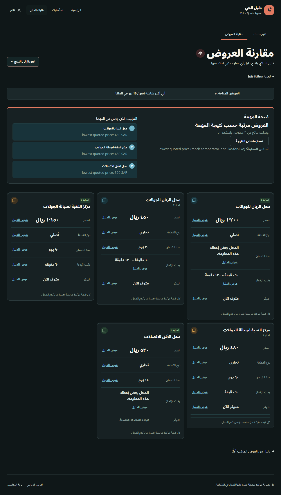
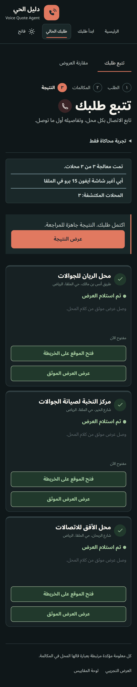

# Voice Quote Agent — R7 frontend

Arabic-first React interface for requesting repair quotes, checking stock, following shop-call events, comparing returned results and inspecting transcript evidence. All application files in this delivery live under `web/`.

## Connected backend preview

Compare Shops now uses R5's FastAPI server over HTTP and native Server-Sent Events. The server still uses mock providers: shops, calls, prices and transcripts are synthetic. No external API keys or paid calls are required.



<details>
<summary>Tracking on mobile, using the backend mock task</summary>



</details>

## Local fixture video walkthrough

This earlier 33-second silent recording uses the local fixture mode: repair request → tracking → comparison → transcript evidence → Quick Call selection, confirmation and answer. It demonstrates the interface; it is not a recording of the HTTP/SSE integration. All data is synthetic and no real calls are made.

https://github.com/user-attachments/assets/475a2a9a-2854-4861-821e-f1b9ca076092

## Screenshots

### Introduction — desktop, dark theme


<details>
<summary>Request details and tracking</summary>


</details>

<details>
<summary>Comparison and transcript evidence</summary>


</details>

<details>
<summary>Quick Call — selection, explicit confirmation and result</summary>


</details>

<details>
<summary>Mobile, light theme and internal mock metrics</summary>


</details>

The same screenshots and recording are also available in [pull request #9](https://github.com/rabehalmutairi/voice-quote-agent/pull/9).

## Delivery status

- Compare Shops defaults to R5's backend mock API, including missing-input questions, streamed shop states, returned comparisons, partial and failed outcomes. The isolated `/demo` route retains local fixtures, including cannot-compare examples.
- Quick Call is a local ADR 002 preview: choose a returned business, review the question and explicitly confirm before starting its simulated call. It does not claim the shared TaskSpec contract or R5 endpoints have been implemented.
- Quotes and inquiry answers show evidence from synthetic shop transcript turns. The UI renders the comparison it receives and does not calculate its own winner.
- `/metrics` contains explicitly simulated metrics; `/demo` provides repeatable fixture scenarios.
- Unsent drafts stay in session memory. API task links include `?task=tsk_...`; refreshing tracking or comparison reopens that task without another Start. Only the theme preference is stored locally. No requests, prices or transcripts are saved in browser storage.
- HTTP/SSE integration uses the existing shared contracts. No live calls, external discovery or production metrics are enabled. Quick Call still depends on R1's proposed contract change and R5's candidate/selection routes.

Quick Call draft details and integration dependencies are documented below.

## Run locally

Use the full integration checkout containing both `app/` and `web/`. Tested with Node.js 24 and Python 3.13; repository CI uses Python 3.12.

In a first terminal at the repository root:

```powershell
python -m venv .venv
.\.venv\Scripts\python.exe -m pip install -r requirements-dev.txt
.\.venv\Scripts\python.exe -m uvicorn app.api.main:app --host 127.0.0.1 --port 8002
```

In a second terminal:

```bash
cd web
npm ci
npm run dev
```

Vite uses `http://localhost:5173` and proxies `/api` to `http://127.0.0.1:8002`. The backend uses mock providers and one worker. No API keys, database or `.env` file are needed. Change `BACKEND_ORIGIN` in a local frontend environment file if the backend uses another port. Production hosting needs an equivalent same-origin `/api` reverse proxy; Vite's development proxy is not a production deployment.

`VITE_TRANSPORT=api` is the default. For the original standalone frontend fixtures, run `npm run dev:mock` (or set `VITE_TRANSPORT=mock`). The frontend reports an unavailable backend; it never silently substitutes local results. Every `VITE_*` value is public; never put secrets there.

## Verify

```bash
cd web
npm ci
npm run lint
npm test
npm run build
npx playwright install chromium
npm run test:e2e:api
npm run build:mock
npm run test:e2e
```

The API suite starts the real FastAPI mock server and checks desktop/mobile journeys for `default`, `one_failed`, `all_failed`, `no_shops` and `retry`. It covers follow-up questions, accepted Start followed by network loss, reload with restored evidence, unknown tasks, switching between saved tasks and local previews, stock checks, and responsive results. PostgreSQL checks require a separate database; the default suite uses memory only.

The original 48 local-fixture Playwright cases remain separate. Unit tests cover contract validation, state reduction, replay deduplication, typed ranges/refusals, task identity, drafts and evidence. Browser checks cover 320–2560px, both themes and 200% text; they do not claim a complete accessibility audit or physical-device/screen-reader testing. Run `npm run build` again after fixture E2E tests when preparing an API-mode build.

Verified for this integration: lint and production build passed; 158 unit/component checks, 25 backend-connected Playwright cases and 48 standalone-fixture Playwright cases passed. Repository Python tests: 482 passed, 3 PostgreSQL checks skipped because no dedicated test database was configured. No real calls or external discovery were tested.

## Review routes

| Route | Purpose |
|---|---|
| `/` | Service introduction and one clearly simulated offer |
| `/request` | Compare Shops or Quick Call request |
| `/tracking` | Active task state and missing-input questions |
| `/comparison` | Returned comparison, exclusions and evidence |
| `/demo` | Repeatable fixture scenarios |
| `/metrics` | Internal mock metrics |

Direct tracking/comparison links without a task show an unavailable state. API links containing `?task=` restore that exact task. For a repair mock task, choose **استخدم مثالًا تجريبيًا** and submit. For Quick Call's local preview, choose **اسأل عني**, open **جرّب مثال الطباعة**, use the example, select a callable shop and confirm. Its scripted reply only answers the supported A2 example; unsupported questions stay unclear.

## Architecture and scope

React/JavaScript, Vite, React Router, plain CSS, runtime payload validation, event-derived state, separated transport hooks and accessible evidence dialogs. Components do not call backend endpoints directly. Contracts in the repository root remain unchanged. The UI, state reduction and transport layers are separated. New backend adapters must validate snapshots and events before they enter state.

The default locale is `ar-SA` and RTL. Noto Sans Arabic is hosted locally under `public/fonts/` with its OFL license. Screenshots use synthetic data:

- [Desktop introduction](docs/screenshots/landing-desktop.png)
- [Mobile introduction, light theme](docs/screenshots/landing-mobile.png)

## Integration details

`api/apiTransport.js` implements the request/answer/start/snapshot/subscribe boundary with `fetch` and native `EventSource`. `backendAdapter.js` maps R5's snake_case data into the frontend view model, preserving exact values, numeric ranges, refused/unclear evidence and stock variants. Requests send only the body R5 accepts (`text`, `area`, `custom_questions`, `max_businesses`); a district label is sent as text when it has no coordinates. Missing structured answers already entered by the user are submitted through the existing answers route.

Bundled JSON schemas in `src/contracts/backend/` are unchanged copies of `/contracts` at `b0dac57`; AJV validates canonical payloads before mapping. A test compares them with the repository contracts so an upstream contract change requires updating the frontend copies together. Frontend-only state still uses the existing provisional view-model schemas. No shared contracts or backend files are modified.

The snapshot omits full transcripts. Before hydrating quotes, the transport replays stored events up to `last_seq` and joins `call.ended` transcripts by `call_id`. The live named-event stream skips already hydrated sequences, preserves the same EventSource for automatic `Last-Event-ID` reconnects, and closes on `comparison.ready` or `task.failed`. A gap or malformed event prompts recovery while retaining same-task results. POSTs are never automatically retried; recovery reads the current task and its history without another Start. An explicit saved-task URL takes precedence over any local demo or Quick Call preview.

Backend tasks are held in memory by default and disappear after a server restart. R5's optional PostgreSQL mode can reopen saved tasks; unfinished tasks after a restart are read-only failures. The frontend displays an unknown-task or restart error instead of creating a replacement.

Quick Call's `target`, `findCandidates` and `selectBusiness` remain local ADR previews, pending R1's contract-change PR and R5's candidate/selection endpoints. They are not sent to the current backend. Metrics and the standalone answer cache have no integrated API endpoints. R1 owns planning/contracts; R5 owns HTTP/SSE/discovery; R6 owns live extraction/comparison.

Business selection never starts a call. Only a returned callable candidate can be selected; unified 920 and toll-free 800 numbers are disabled. No chosen business is substituted. One or two explicit questions are supported. UI content checks are best-effort feedback; backend authorization, calling policy and rate limits remain backend responsibilities.

Each displayed evidence claim must match the indicated shop transcript turn. Unknown, missing, unclear and refused values remain distinguishable. Copied summaries preserve option identity, returned ranking and simulation provenance; untraceable values are omitted. Mock metrics derive from synthetic fixture records and do not measure production performance.

## Data and security

All bundled requests, prices, shops and transcripts are synthetic. No paid provider is called. Keep API keys out of the frontend and all VITE variables; only .env.example belongs in version control. Render external content as text, validate URL protocols and do not log requests, phone numbers or transcripts to analytics. Production HTTP/SSE needs HTTPS and backend authorization. The browser stores only theme preference; drafts/tasks are in memory and clear on reload.

Noto Sans Arabic is distributed locally with its SIL OFL license in public/fonts/OFL-NotoSansArabic.txt. Responsive and keyboard checks target accessible operation; no complete WCAG certification, physical-device run or real screen-reader session is claimed.
